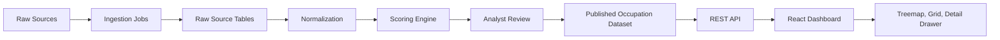

# Architecture

## Overview

The India Jobs Dashboard is a data product with four layers:

1. Ingestion: load structured occupation files, public survey data, job postings, salary reports, and curated analyst sheets.
2. Enrichment and scoring: normalize occupations/locations, classify sectors, calculate scores, and store rationales.
3. API: expose versioned REST endpoints for dashboard views and occupation detail.
4. Frontend: React shell with D3 treemap, filters, URL state, detail drawer, and export-friendly summaries.

## Target Stack

- Frontend: Vite, React, TypeScript, D3.
- Backend: Node.js, Express or Fastify, TypeScript.
- Database: PostgreSQL 16.
- Validation: Zod or equivalent schema validation.
- Tests: Vitest, React Testing Library, Playwright.
- CI/CD: GitHub Actions, Docker.

## Component Diagram

## Frontend Components

- `JobsDashboardPage`: route shell, data loading, URL state orchestration.
- `FilterBar`: sector, metro category, skill, education, score ranges, state, tier, search.
- `Treemap`: D3 layout and tile rendering.
- `ScoreLegend`: metro score gradient and category labels.
- `OccupationGrid`: accessible table/list fallback and dense comparison view.
- `OccupationDrawer`: selected occupation detail, rationales, sources, aliases, salaries, employers.
- `DataFreshnessBanner`: score version, latest ingestion date, stale/partial warnings.
- `ExportControls`: CSV/JSON export of current filtered view.

## Backend Components

- `OccupationService`: read published occupations and detail views.
- `ScoreService`: compute or retrieve score versions.
- `LocationService`: city/state/tier normalization and metro categorization.
- `IngestionService`: parse raw files, validate, quarantine errors.
- `ReviewService`: analyst approval flow for scoring versions.
- `ExportService`: filtered CSV/JSON responses.

## Data Flow

1. Import source files into raw tables.
2. Validate required columns and source metadata.
3. Normalize occupation titles and aliases.
4. Normalize locations to city, district, state, region, and tier.
5. Map occupations to India sector, skill level, and education band.
6. Calculate scores using documented scoring rules.
7. Generate rationales from score components and source evidence.
8. Analyst reviews samples, exceptions, and low-confidence records.
9. Publish a score version.
10. API serves the latest published version by default.

## API Flow

- `GET /api/v1/occupations` returns dashboard-ready rows.
- `GET /api/v1/occupations/:id` returns full detail.
- `GET /api/v1/facets` returns filter counts.
- `GET /api/v1/score-versions` returns published versions.
- `POST /api/v1/ingestions` creates an ingestion job for authorized maintainers.

## State Management

URL-backed state:

- `q`
- `sector`
- `metro`
- `skill`
- `education`
- `state`
- `tier`
- `metroMin`
- `metroMax`
- `techMin`
- `growthMin`
- `selected`
- `version`

Client-only state:

- loading/error state
- drawer open/closed
- hover tile
- treemap dimensions

## Reliability

- API should serve stale published data if ingestion is down.
- Ingestion failures must not affect the latest published score version.
- All score changes should be append-only in `occupation_scores`.
- The frontend must show data freshness and partial-source warnings.

## Security And Privacy

- Do not ingest personally identifiable jobseeker data.
- Keep admin ingestion endpoints authenticated.
- Rate-limit public API endpoints.
- Sanitize uploaded files and reject unknown schemas.
- Store source URLs and aggregated facts, not copied proprietary posting text unless licensed.

